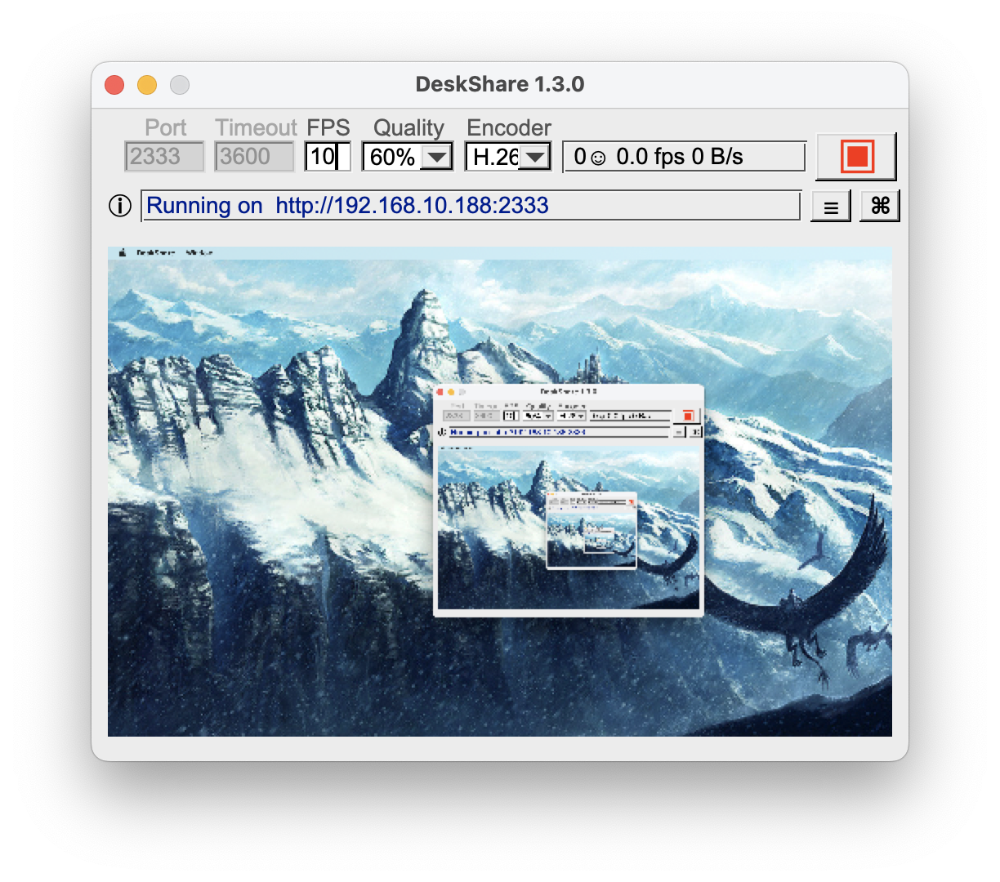

# DeskShare

DeskShare is a desktop sharing tool that can be accessed via a web browser.

[More in GitHub](https://github.com/xspin/deskshare)

## Dependencies
- [libuv](https://github.com/libuv/libuv)
- [FLTK](https://github.com/fltk/fltk)
- [OpenSSL](https://github.com/openssl/openssl)

## Building

```bash
# build
cmake . -B build && cmake --build build
```

## Preview

